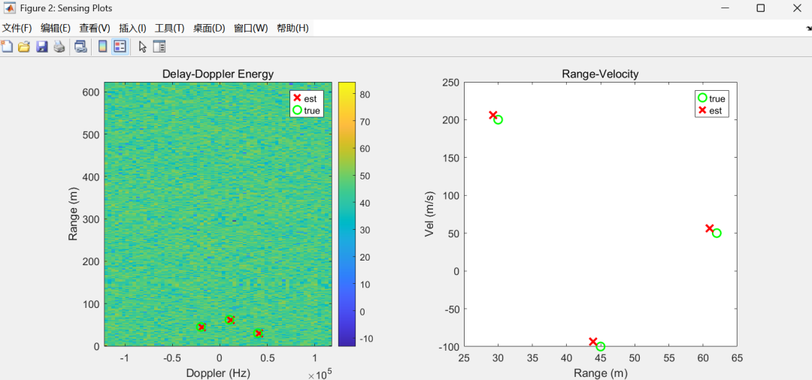
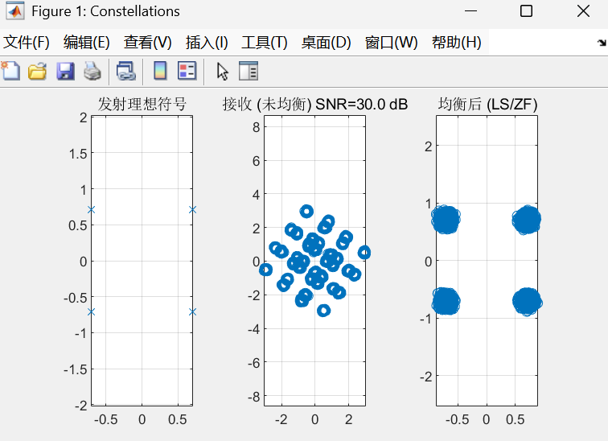

# 30GHz millimeter wave + OTFS! This code achieves integrated communication and perception, with multi-target positioning and high-speed data transmission.

This presentation will discuss the implementation of OTFS's advantages in a single system: using the same signal to transmit QPSK data and precisely detect multiple targets' positions and speeds, while also being compatible with 30GHz millimeter-wave (high bandwidth, high resolution), perfectly aligned with the current hot research direction of 6G, achieving maximum practicality!
The core module of the code is dissected: from transmission to results, the entire system process is very clear, like a "signal pipeline," we follow it step by step:
1. Basic parameters: Set the "hardware specifications" for the system first, then define the "rules of the game." I have organized key parameters into a table, which is easy to understand:
Parameters category  
Core parameters  
Literal interpretation  
Signal specification  
M=256 (delay bins), N=64 (Doppler bins)  
The "anchor point" for perception resolution: the smaller the bins, the more accurate the distance / velocity estimation, for example, if the delay bins are small, it can be precisely measured to centimeters  
Modulation and carrier  
QPSK modulation, 30GHz millimeter wave  
Communication side: QPSK is a "familiar face" for medium and high-speed data transmission; perception side: millimeter waves have short wavelengths (only 1cm), so they are highly sensitive to velocity changes, making measurement extremely accurate  
Multi-target configuration  
3 targets (30/45/62 meters, 200/-100/50m/s)  
Simulate real scenarios: for example, three cars, one moving forward, one moving backward, perfectly reproducing the situation of multiple targets coexisting  
Channel noise  
SNR=10~20dB  
Simulate real-world signal interference, see how the system can still maintain performance under "noisy" conditions  
2. OTFS transmitter: The logic for generating "compatible signals" at the transmitting end is particularly smooth, like "packing data":
Random bit generation → QPSK modulation (bits to complex symbol) → Mapping to delay-Doppler domain → Singular Fourier Transform (ISFFT) to time-frequency domain → Time-domain signal + serialization. Here, the key point: This signal is a "dual-task player" — it can both extract the communication data from the receiver end and use it as a "probe wave," comparing it with the received signal to find the target, achieving two goals in one go!
3. Multi-target Channel: The analog signal "true transmission path" signals from transmission to reception will go through multi-target's "interference", the code precisely simulates this point:
•  
Latency: The farther the target is, the later the signal arrives (Latency = 2× distance / speed of light, after all, the signal has to travel back to the target before it can be reflected).
•  
Doppler shift: the faster the target moves, the more pronounced the frequency deviation (Doppler = 2× velocity / wavelength, especially noticeable in millimeter waves with short wavelengths).
•  
Attenuation: After signal reflection, it will "weaken" and "phase drift", the code uses random complex coefficients to simulate, which is very close to reality.
•  
Add Noise: Finally, add interference with the awgn function to restore the real wireless environment.
4. Receiver: The "core battlefield" of the integrated senses is the receiver! Using the same set of signals, you can simultaneously perform two major tasks:
(1) Multi-objective Perception: 3-Step Positioning Accurate to Insanely Extreme Targets - Identifying the "distance + speed" of three targets, using "rough search + fine search" to ensure precision. The process is incredibly classic.
1  
Broad search: "Time Delay - Doppler Energy Spectrum"
Traverse 256×64=16384 grid points, generate "ideal OTFS signal" at each point and calculate the "correlation" of received signals - areas with high correlation have higher energy, which is likely to contain a target (profile matrix is this "treasure map").
2  
Peak detection: Exclude "false targets"
In the energy spectrum, there inevitably exist "false peaks" caused by noise. To perform "non-maximum suppression" using the nms2d function: select the top 3 highest peaks, and suppress the peaks within a 5x3 grid surrounding each peak to avoid redundant detection.
3  
Precise Search: Enhance Accuracy with Golden Ratio
The coarse search is conducted at a "grid level" accuracy, while the fine search employs the "Golden Ratio Method" to refine around peaks, increasing the distance precision from "bin-level" to "sub-bin-level" (for example, from 0.1 meters to 0.01 meters), and finally outputting the estimated distance (estRange), velocity (estVelocity), and reflection coefficient (estAlpha) for each target.
(2) Communication Restoration: A significant reduction in error rate after equalization requires extracting QPSK data from the received signal. The key is "eliminating channel interference".
•  
Principle: Given the channel response (h_dd matrix), use 2D-FFT to convert into time-frequency domain, perform LS/ZF equalization (simply said, "dividing the received signal by the channel response", eliminating interference).
•  
Effect: Compare the SER (Symbol Error Rate) and BER (Bit Error Rate) before and after balancing - the error rate directly drops after balancing, proving that communication is ultra-reliable!
5. Results Visualization: Whether the results are good or not, you can tell by looking at the graphs. The code also provides an extremely intuitive visualization, so you don't need to understand formulas to get performance:
•  
Constellation chart: 3 sub-charts for comparison, regular emission symbols, uneven symbols scattered, regrouped after equilibrium, the effect of equilibrium is immediately apparent.
•  
Perception Results Graph: The left graph is an energy spectrum, with the red "×" representing estimated targets and the green "○" representing actual targets, almost overlapping. The right graph is a distance-velocity scatter plot, with errors so small as to be negligible (within a distance difference of 0.1 meters and a velocity difference of 1 m/s).
This code has four core values that are missed at your peril!
True Sensor-to-Communication Integration: A single set of signals and links, capable of handling both communication and perception simultaneously without the need for additional hardware, a necessity for 6G.
2  
Multi-target + High Precision: Supports simultaneous positioning of 3 targets, combining coarse search and fine search, with sufficient precision, suitable for vehicle networking and drone inspection.
3  
Millimeter Wave Landing: Compatible with 30GHz millimeter waves, meeting the requirements of high bandwidth and high resolution in 5G-A/6G, not "talking about it on paper".
4  
Verifiable Performance: Both the "real vs. estimated" error comparison and the communication SER/BER metrics are visible and tangible.
How to use it for different readers? See here!
Technical enthusiasts: Deeply explore the mathematical principles of "Sinc Fourier Transform" and "Golden Ratio Optimization", even by modifying parameters for comparison (e.g., adjusting SNR to observe performance changes).
•  
Application of Party: Combined with the Internet of Vehicles scenario - With this system, vehicles can communicate data with each other and detect the distance and speed of multiple vehicles ahead, avoiding collisions, which is very convenient.
•  
Beginners: There's no need to fret over formulas; remember "time delay corresponds to distance, Doppler corresponds to velocity." Treat the energy spectrum as a "radar scan map," and the peak is the target—a smooth entry into the field.
In summary, this code serves as an excellent practical example for "OTFS-ISAC". Whether you are engaged in research, developing, or wishing to master the integration of sensory technology, it is worth running and modifying! If you have any questions or would like to discuss a specific aspect further, feel free to ask in the comments section.
End

## Images

<!-- PAYMENT_BLOCK -->

## Get this dataset

- Payment link (Stripe): [Buy now](https://buy.stripe.com/3cs8yP7sY87d0vu9AB)
- Payment QR code: 

<!-- /PAYMENT_BLOCK -->
